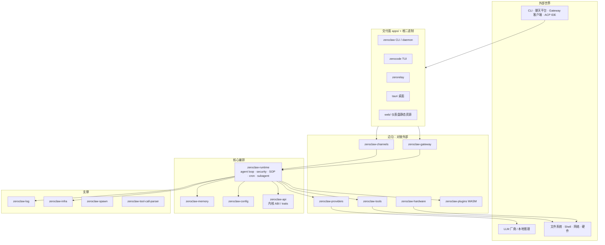

# 01 — 总览与形态

## 1. 它是什么

ZeroClaw 是一个 **个人 AI 助手运行时**（不是单一 chatbot SDK）：

- **本地优先**：配置、密钥、会话、记忆可落在本机（或自建存储）。
- **多入口**：CLI（`zeroclaw`）、聊天通道（Telegram / Discord / Matrix …）、HTTP Gateway + Web Dashboard、ACP IDE 桥、桌面（Tauri）、终端 UI（`zerocode`）。
- **可扩展边沿**：Provider / Channel / Tool / Memory / Peripheral 通过 `zeroclaw-api` 特质接入；能力也可走 WASM 插件宿主。
- **有纪律的编排**：自治等级、工具审批、沙箱、SOP（标准作业程序）、cron、子代理与委托。

愿景表述见官方 FND-001：任意硬件上可跑、低配置开销、不依赖外部托管服务也能工作。

## 2. 分层总图



读图要点：

1. **Runtime 是中枢**，不直接「成为」某个 IM 或某个 LLM 实现。
2. **API crate 是契约层**：具体实现落在 providers / channels / tools / memory / plugins。
3. **Gateway 与 Channels 是平行入口**，都汇入 Runtime 的投递 / 回合路径。

## 3. 仓库物理结构（怎么找代码）

```text
zeroclaw/                         # 工作区根 + 主二进制 src/main.rs
├── crates/
│   ├── zeroclaw-api/             # 公共 traits / 线协议形状
│   ├── zeroclaw-runtime/         # 编排核心（最大、最常改）
│   ├── zeroclaw-config/          # TOML schema、密钥、工作区解析
│   ├── zeroclaw-providers/       # LLM 客户端 + 路由/重试
│   ├── zeroclaw-channels/        # 消息通道 + orchestrator
│   ├── zeroclaw-gateway/         # REST / WS / dashboard API
│   ├── zeroclaw-tools/           # 内置工具实现
│   ├── zeroclaw-memory/          # 会话记忆 / 向量检索
│   ├── zeroclaw-plugins/         # WASM 组件宿主
│   ├── zeroclaw-hardware/        # GPIO/I2C/SPI/USB 等
│   ├── zeroclaw-log/             # 唯一日志发射面
│   ├── zeroclaw-infra/           # 进程级支撑（SQLite session 等）
│   ├── zeroclaw-spawn/           # 带归因的 tokio spawn
│   ├── zeroclaw-tool-call-parser/
│   ├── zeroclaw-sop-graph/       # SOP 图相关
│   ├── zeroclaw-commands/        # 命令面支撑
│   ├── zeroclaw-macros/          # derive / 注册宏
│   └── …
├── apps/
│   ├── zerocode/                 # 终端 UI（只依赖 api 契约）
│   ├── zerorelay/                # 中继
│   └── tauri/                    # 桌面壳
├── web/                          # 仪表盘前端（构建进发布物）
├── docs/book/                    # 官方 mdBook（权威）
└── notes/tech-framework/         # 本笔记（仅本分支）
```

## 4. 进程与用户可见面

| 面 | 作用 | 典型入口 |
|---|---|---|
| CLI | 安装、配置、doctor、一次性 agent、cron/SOP 管理 | `zeroclaw …` |
| Daemon / service | 长驻：通道监听、心跳、调度 | `zeroclaw daemon` / systemd 等 |
| Gateway | 本机/内网 HTTP+WS API、仪表盘、webhook | `zeroclaw gateway` |
| Channels | 把聊天平台消息变成 Runtime 回合 | 配置 `[channels.*]` |
| Zerocode | 独立 TUI，经 RPC/契约与 Runtime 协作 | `zerocode` |
| Plugins | 沙箱内扩展 tool/channel/… | WASM 组件 + WIT |

## 5. 设计口号（读代码时很有用）

来自 `AGENTS.md` / FND 的约束，影响几乎所有 PR：

- **单一事实来源**：配置字段、策略、状态不要复制到第二份缓存当权威。
- **默认关闭的新外部面**：新网络/能力用允许名单，而不是先放开再拦。
- **生产路径传播错误**：少用 `unwrap`/`expect`；死代码删掉或接上，不要静默 `allow(dead_code)`。
- **微内核方向（RFC #5574）**：Runtime 逐步变瘦；能力靠 feature flag 与插件边界外移。
