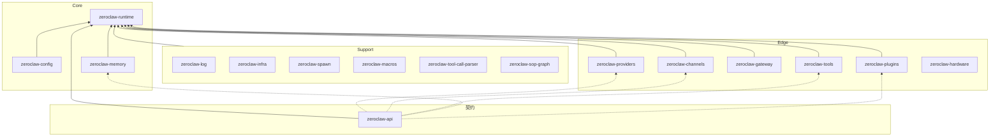
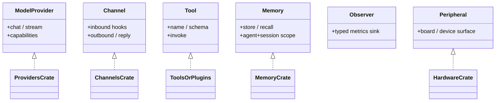

# 02 — Crate 分层与内核 ABI

## 1. 三层模型

官方把工作区粗分为 **Core / Edge / Support**（见 `docs/book/src/architecture/crates.md`）。下图强调 **依赖方向**：边沿实现依赖契约；Runtime 编排依赖契约与配置；尽量避免 Edge 反向依赖 Runtime 实现细节。

> 箭头「指向被依赖方」：`A --> B` 表示 A 被 B 使用 / B 依赖 A 的能力面。实际 Cargo 边更密；改依赖前先看对应 crate 的 `Cargo.toml` 与 architecture-map。

## 2. 核心 crate 功能表

| Crate | 功能说明 | 改它时先读 |
|---|---|---|
| **zeroclaw-api** | 内核 ABI：`ModelProvider`、`Channel`、`Tool`、`Memory`、`Observer`、`Peripheral`、`RuntimeAdapter` 等 | `crates/zeroclaw-api/src/` |
| **zeroclaw-runtime** | Agent 循环、安全策略、SOP、cron、subagent、skills、daemon/service、RPC | architecture + request-lifecycle |
| **zeroclaw-config** | TOML schema、自治等级、密钥加密、工作区/安装根解析、迁移 | config-lifecycle |
| **zeroclaw-providers** | 各 LLM 客户端、compatible 复用、路由、重试/冷却/回退、流式解析 | providers/* + provider-routing-lifecycle |
| **zeroclaw-channels** | 30+ 通道实现 + orchestrator（草稿、拆分、ACP） | channel-runtime-lifecycle |
| **zeroclaw-gateway** | REST / WebSocket / 仪表盘 API / webhook 入口 | gateway/api.md |
| **zeroclaw-tools** | 内置工具（shell、文件、浏览器、HTTP、硬件探测…） | tools/* + tool-execution-lifecycle |
| **zeroclaw-memory** | 会话记忆；默认 SQLite，可选 Postgres/向量 | memory-payload-lifecycle |
| **zeroclaw-plugins** | WASI / 组件模型插件宿主（燃料与内存限额） | plugin-protocol |
| **zeroclaw-hardware** | 板级外设抽象 | hardware/* |
| **zeroclaw-log** | **唯一**日志发射面：JSONL、归因、`/api/logs`、Observer 桥 | logging.md |
| **zeroclaw-spawn** | `spawn!`：后台任务继承归因 span | logging / observability |
| **zeroclaw-infra** | 进程级工具（debounce、watchdog、session SQLite 等） | runtime-state-and-persistence |
| **zeroclaw-tool-call-parser** | 统一各模型工具调用语法 | providers/streaming |
| **zeroclaw-sop-graph** | SOP 图结构支撑 | sop/* |
| **zeroclaw-commands** | CLI/命令相关共享逻辑 | — |
| **zeroclaw-macros** | 配置/工具/通道注册宏 | — |
| **zeroclaw-eval** | 评测相关 | — |
| **zeroclaw-tls / relay-proto / dist / buildinfo** | TLS、中继协议、分发、构建信息 | — |

## 3. `zeroclaw-api`：为什么叫「内核 ABI」

新能力的默认路径是：

1. 在 **api** 里确认或扩展 trait / 共享类型（谨慎，兼容面）。
2. 在对应 **edge/core 实现 crate** 里落地。
3. 经 **factory / registry / feature gate** 接到 Runtime，而不是在 Runtime 里写死第三方 SDK。

常见 traits（名称以源码为准）：

**Zerocode** 刻意只依赖 api 契约，不直接拖 Runtime/Config/Channel 实现——这是「UI 与编排解耦」的样板。

## 4. Runtime 内部模块地图（心智模型）

`crates/zeroclaw-runtime/src/` 里高频目录：

| 模块 | 职责 |
|---|---|
| `agent/` | 主回合循环、流式、工具编排 |
| `security/` | 策略、沙箱探测、紧急停止等 |
| `sop/` | 标准作业程序引擎 |
| `subagent/` | 子代理生命周期 |
| `cron/` `daemon/` `heartbeat/` | 调度与长驻 |
| `skills/` | Skill 编译与执行 |
| `rpc/` | 对 zerocode 等的 RPC |
| `service/` | systemd / launchd / Windows Service |
| `observability/` `cost/` | 观测与成本 |
| `plugin_runtime.rs` 等 | 与插件宿主协作 |

微内核路线图目标：把「不可再减的内核」压到 agent loop + 策略执行；其余靠 feature 与边界外移。

## 5. Feature flags（构建旋钮）

实用心智：

- **默认 feature**：日常可用核心。
- **`ci-all`**：CI 全开。
- **`channel-<name>`**：按通道裁剪二进制。
- **`gateway` / `hardware` / `plugins-wasm*` / `acp-bridge` …**：能力组开关。
- Provider 多数 **不按 feature 裁剪**（全部编译进 providers crate）；通道才是主要体积旋钮。

完整表见根 `Cargo.toml` 的 `[features]`。
