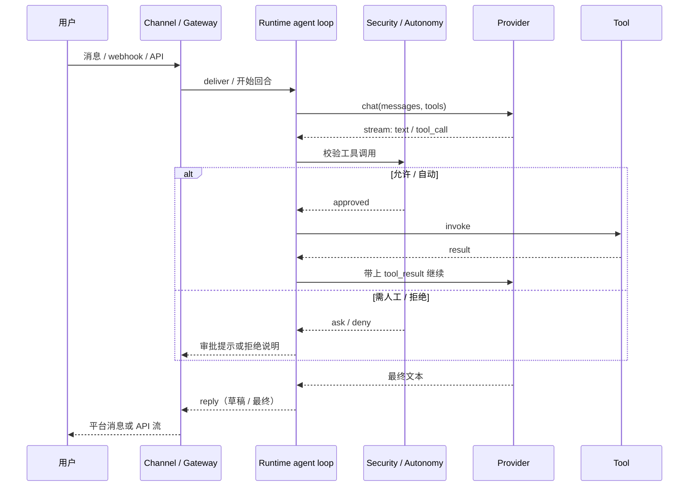
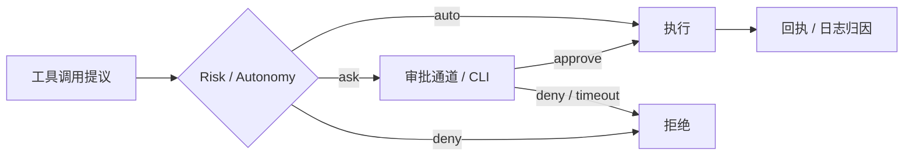

# 03 — 请求生命周期与安全

## 1. 一次用户消息怎么走完

简化序列（官方完整版：`docs/book/src/architecture/request-lifecycle.md`）：

分层责任：

| 阶段 | 谁负责 | 注意 |
|---|---|---|
| 入站校验、配对、鉴权 | Channel / Gateway | 通道是用户可见信任边界 |
| 回合编排、历史、取消 | Runtime | 不要在 adapter 里再做一套 mini-orchestrator |
| 线路完成 / SSE 解析 | Provider adapter | 整次调用重放归 Runtime |
| 草稿/打字指示 | Channel orchestrator | 与 provider token 流式区分开 |
| 工具策略与审批 | Runtime security + risk profile | 通道只负责投递审批 UI |

## 2. 安全与自治（功能说明）

配置侧通过 **risk / autonomy** 控制「工具能不能自动跑」：

| 概念 | 含义 |
|---|---|
| 自治等级 | 例如只读 / 监督 / 全自动等（见 config schema） |
| Risk profile | 按工具名或通配决定 auto / ask / deny |
| Approval route | 审批可路由到另一通道的操作者 |
| Sandbox | OS 级隔离（如 Landlock）仍可叠加 |
| Workspace / forbidden paths | 文件系统边界 |
| Tool receipts | 工具执行留痕，供审计与安全叙述 |

原则：**新外部面默认关闭**；允许名单优先于黑名单。

## 3. 流式与「不可变事件」

两个容易混的概念：

1. **Provider token streaming**：模型增量 token —— Runtime 拥有。
2. **Channel draft streaming**：给用户看的「正在输入 / 草稿」—— Channel lifecycle 拥有。

一旦某类事件对用户/日志已「不可撤回地发出」，Provider 层不应再悄悄整段重放冒充同一次调用（见 provider-routing-lifecycle / streaming 文档）。

## 4. 代码落点（快速跳转）

| 关注点 | 优先位置 |
|---|---|
| CLI 总调度 | `src/main.rs` |
| Agent 循环 | `crates/zeroclaw-runtime/src/agent/` |
| 安全策略 | `crates/zeroclaw-runtime/src/security/` |
| 通道编排 | `crates/zeroclaw-channels/`（含 `orchestrator/`） |
| Gateway 路由 | `crates/zeroclaw-gateway/` |
| 工具执行 | `crates/zeroclaw-tools/` + runtime tool loop |
| 配置 schema | `crates/zeroclaw-config/src/schema.rs`（体量很大，按字段搜） |
