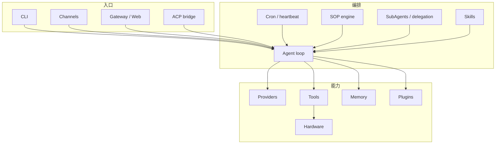
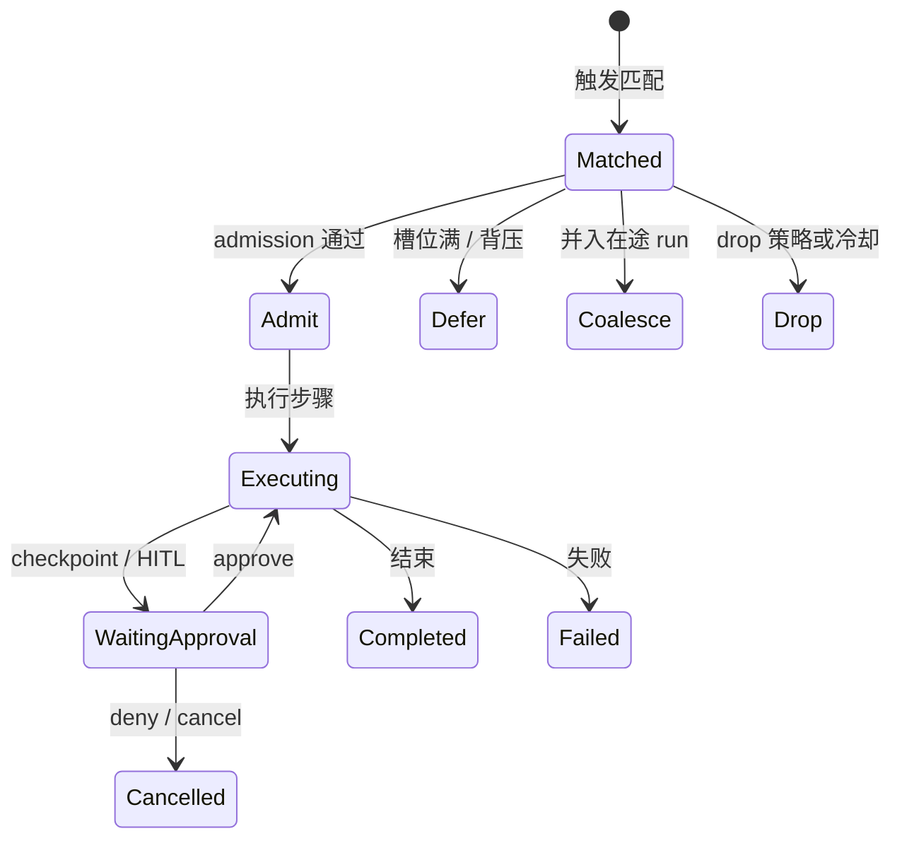

# 04 — 子系统功能说明

## 1. 子系统关系图

## 2. Channels（消息通道）

**功能：** 把外部 IM / 邮件 / 语音等变成统一的入站事件，并把 Runtime 的回复送回平台。

**要点：**

- 均实现 `Channel` trait；大多 **feature-gated**，可裁剪编译。
- Inbound 与 outbound **分钩子**：配对、鉴权、限流、回复拆分各自清晰。
- `orchestrator/` 处理多段消息、草稿更新、ACP server 等横切行为。
- 通道是 **信任边界**：未校验的入站不得当成本地特权。

**配置形态：** `config.toml` 里各 `[channels.<platform>]` / 带 alias 的实例。

## 3. Providers（模型）

**功能：** 调用云端或本地 LLM；统一流式与工具调用增量。

**要点：**

- 一族一文件（Anthropic、OpenAI、Ollama…）+ 大量 **OpenAI-compatible** 复用。
- **Router**：按 hint / 配置选模型路由。
- **Reliable 包装**：重试、冷却、跨 profile 回退。
- 请求的「想用的模型」vs「实际服务的模型」归因要留在正确层（见 provider-routing-lifecycle）。

## 4. Tools（工具）

**功能：** Agent 可调用的动作（读文件、shell、浏览器、HTTP、硬件探测…）。

**要点：**

- 与 CLI 子命令不是一回事。
- 注册经 factory；描述字符串走 Fluent i18n。
- 执行前过安全策略；执行后可有 **receipts**。
- 共享状态所有权见 ADR-004（勿在工具间偷偷复制权威状态）。

## 5. Memory（记忆）

**功能：** 会话与长期记忆的存取、可选嵌入与向量检索、巩固（摘要/事实）。

**要点：**

- 默认 SQLite；Postgres（及 pgvector）用于多实例共享写。
- 必须保持 **agent / session 作用域**，避免串话。
- 与「上下文裁剪 / 媒体载荷」边界见 memory-payload-lifecycle。

## 6. Gateway + Web Dashboard

**功能：** 把 Runtime 暴露为 HTTP/WS 服务；托管仪表盘；承接 webhook。

**要点：**

- REST：会话、记忆、状态、cron、SOP 管理等。
- WebSocket：流式响应。
- 默认配对 / 绑定策略偏安全；`allow_public_bind` 是显式危险开关。
- 前端在 `web/`，发布时常嵌入 crate 产物。

## 7. SOP（标准作业程序）

**功能：** 用 `SOP.toml` + `SOP.md` 描述可触发、可检查点、可审批的流程引擎。

**要点：**

- 触发源：manual / webhook / cron / channel / filesystem / mqtt / …  
- 并发：`max_concurrent`（每 SOP）与 `sop.max_concurrent_total`（全局）。
- `admission_policy`：`parallel` / `hold` / `coalesce` / `drop`。
- HITL checkpoint 与 pending-approval 池。
- CLI：`zeroclaw sop list|show|validate|…`；Gateway 也有管理 API。

## 8. Cron / Daemon / Heartbeat

**功能：** 定时任务、长驻进程、健康心跳与服务集成。

**要点：**

- Cron job 可带投递通道（announce）、agent alias、工具限制。
- Daemon 拉取通道监听 + 调度；service 模块对接 systemd/launchd/Windows。
- 与 SOP cron 触发互补：一个偏「通用定时 agent 任务」，一个偏「流程引擎触发器」。

## 9. SubAgents / Delegation

**功能：** 把工作委派给子代理（独立审批/风险配置可能性）。

**要点：**

- 子代理权限与父会话隔离策略要读 `agents/delegation.md`。
- 取消、重启恢复与「谁拥有状态」见 background-work-lifecycle。

## 10. Skills

**功能：** 可打包的技能（提示词/工具约定/流程片段），由 Runtime skills 子系统编译执行；亦可与插件包协同。

## 11. Plugins（WASM）

**功能：** 在进程内沙箱加载组件模型插件，扩展 tool/channel/memory/skill 等。

**要点：**

- WASI + 燃料/内存限制。
- 后端可选 cranelift / pulley 等（feature 分类见 FND-001）。
- 协议权威：`docs/book/src/developing/plugin-protocol.md`。

## 12. Hardware / Peripherals

**功能：** 板级 IO 与 Peripheral trait，使 Agent/SOP 能读传感器、写 GPIO 等。

嵌入式/边缘场景是愿景的一部分，而非附属 demo。
