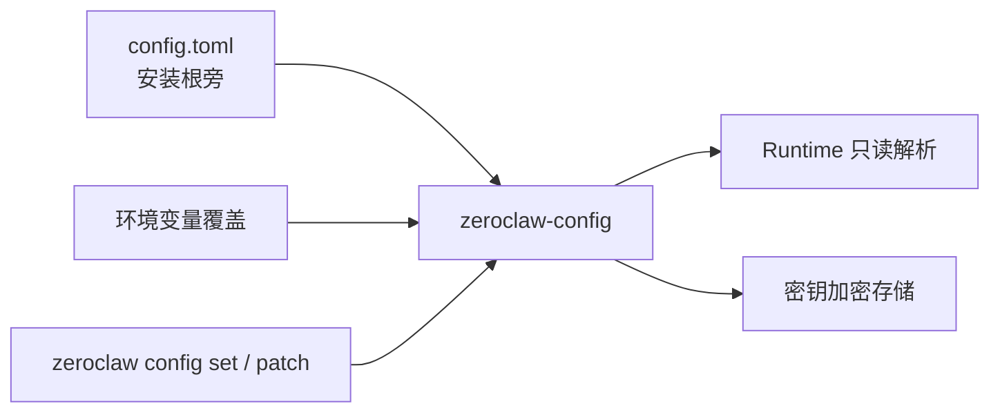
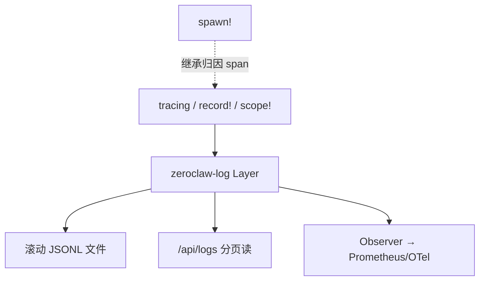
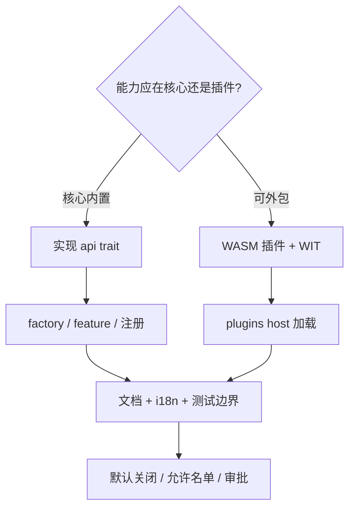

# 05 — 配置、持久化、观测与运维

## 1. 配置权威

要点：

- Schema 有 version；迁移在 config crate。
- **安装根**（`install_root_dir`）常由 `config_path` 的父目录推出；`shared/sops`、agents、skills 等多挂在此树下。
- `data_dir` 偏运行时数据（会话、cron db、日志等）——改路径前确认各子系统解析函数。
- 不要把「当前生效策略」快照进长期 handle 后假装它仍是权威；优先借引用/闭包现查。

权威文档：`architecture/config-lifecycle.md`、`reference/config.md`（多由 schema 生成）。

## 2. 状态与持久化边界

| 状态 | 典型位置 | 备注 |
|---|---|---|
| 配置 | `config.toml` + secrets | 用户权威 |
| 会话 / agent 状态 | infra / runtime 后端 | 与 memory 区分 |
| 对话记忆 | zeroclaw-memory | agent+session 作用域 |
| 日志 | zeroclaw-log JSONL | 唯一发射面 |
| Cron jobs | data 下 cron db | CLI/Gateway 管理 |
| SOP runs | SOP store（可持久化） | 审批恢复依赖 persist |
| 成本 | cost 子系统 | 可查询/展示 |
| Gateway 元数据 | gateway 侧 | 配对等 |

细节：`architecture/runtime-state-and-persistence.md`。

## 3. 日志与归因

每个重要事件应能带上 `agent_alias` / `channel` / `session_key` 一类归因，便于多租户式本机部署排障。

## 4. i18n

| 面 | 机制 |
|---|---|
| CLI / Runtime 用户可见字符串 | Fluent：`zeroclaw_runtime::i18n` |
| Zerocode | 独立 Fluent 目录 |
| Web dashboard | TypeScript `web/src/lib/i18n.ts` |
| 文档 | 英文 Markdown 为源；翻译走维护流程，勿手改生成物 |

日志与 panic 文案保持英文稳定键。

## 5. 测试与 CI 心智

- 行为断言尽量落在 **用户真实边界**（CLI 退出码、通道投递、API 响应），而不只测私有 helper。
- 常见本地命令：`cargo fmt`、`clippy -D warnings`、`cargo test`；大范围用 `./dev/ci.sh all`。
- PR 合入默认 **squash**；基线分支是 **`master`**。
- 风险标签按 **后果** 而非路径：安全/凭证/治理常升到 `risk:high` + 双 Core。

## 6. 扩展一张能力时怎么走

对照 `architecture-map.md` 选对「先读哪篇」。

## 7. 延伸阅读清单（官方）

| 主题 | 路径 |
|---|---|
| 架构总览 | `docs/book/src/architecture/overview.md` |
| Crates | `docs/book/src/architecture/crates.md` |
| 请求生命周期 | `docs/book/src/architecture/request-lifecycle.md` |
| 通道生命周期 | `docs/book/src/architecture/channel-runtime-lifecycle.md` |
| 工具执行 | `docs/book/src/architecture/tool-execution-lifecycle.md` |
| 后台工作 | `docs/book/src/architecture/background-work-lifecycle.md` |
| 配置生命周期 | `docs/book/src/architecture/config-lifecycle.md` |
| 日志 | `docs/book/src/architecture/logging.md` |
| 安全 | `docs/book/src/security/overview.md` |
| SOP | `docs/book/src/sop/index.md` |
| 插件协议 | `docs/book/src/developing/plugin-protocol.md` |
| 微内核基础 | `docs/book/src/foundations/fnd-001-intentional-architecture.md` |
| 贡献地图 | `docs/book/src/contributing/architecture-map.md` |

## 8. 本笔记维护约定

- 仅在 **`notes/tech-framework` 分支** 演进；不向 `zeroclaw-labs/zeroclaw` 开 PR。
- 与官方文档冲突时：**以官方 book + 源码为准**，再回改本笔记。
- 更新时在 `README.md` 顶部刷新「对齐 revision」的 commit / 版本号。
